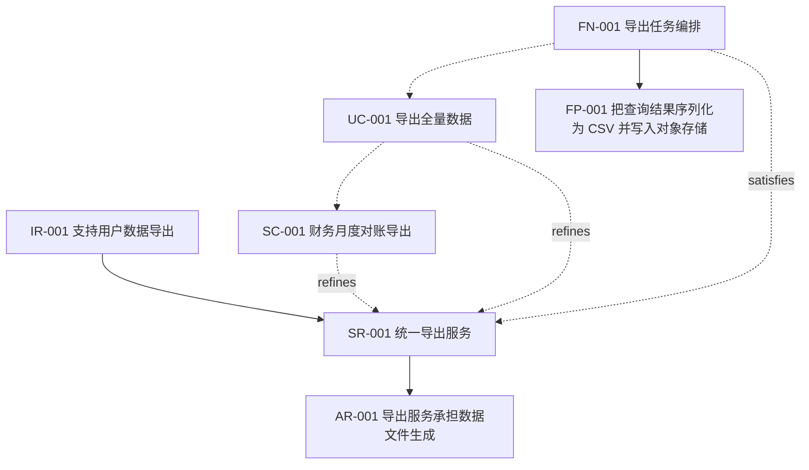

# BaiZeArchitect

BaiZe 软件全量设计套件：把需求从录入逐层拆成可追溯、可校验的设计条目（CLI ＋ 十个 skill ＋ pi/Claude Code 注入）。

不是应用本身——是装进 AI coding agent 的能力包。

## 包里有什么

- **CLI** —— `baize <new|validate|status|accept|rename|migrate>`：`new <layer>` 发号建条目，`validate` 校验，`status` 查链的全貌，`accept` 认领一条 `statement` 与 `acceptance`，`rename` 把条目里的清单引用跟到新 slug，`migrate` 把旧模型的条目搬到新形状（两条改写命令都默认 dry-run，`--write` 才落盘）。
- **十个 skill** —— 六个段 skill（`baize-ir` / `baize-sr` / `baize-ar` / `baize-scenario` / `baize-usecase` / `baize-function`）＋ 三个纪律 skill（`baize-validate` / `baize-review` / `baize-revise`）＋ 入口 `using-baize`。
- **pi 扩展** —— `extensions/baize-context.ts`：会话启动时注入 `using-baize` 的正文。
- **Claude Code plugin** —— `.claude-plugin/plugin.json` ＋ 一个 SessionStart hook，注入**同一份**正文。
- **探针** —— `probes/`：30 条真实模型调用，挡 skill 的触发退化。

**只想用** → [跑起来](#跑起来)。**想改这个仓库** → [改这个仓库](#改这个仓库)。

## 怎么运转

一条链长这样——`test/fixtures/chain-sample` 里那条真实的七层链：



实线是 `parent`（分解）；虚线都是多对多——带标签的是认领边（`refines` / `satisfies`：方案层条目接住哪条 SR），不带标签的是关联边（`appearsIn` / `realizes`）。

挑它当例子不是为了好看：它是 `npm run check:fixture` **每次都会严格校验**的那条链，所以这张图不会烂。

条目是 `baize/` 下的 markdown，与代码同仓、进 git。每个术语到底指什么，见 [`CONTEXT.md`](CONTEXT.md)——这里不重复它的定义。

## 跑起来

> [!NOTE]
> 本仓 `private: true`、版本 `0.0.0`，**尚未发布**：今天只有「从 checkout 装」这一条路。
> 还有一件事容易误会：**本仓根目录没有 `baize/`**。它是工具，不是一份设计——设计资产长在**你自己项目**的 `baize/` 下。

### 装进你的 agent

```sh
# pi（1.2.0 实测；-l 装进项目本地的 .pi/settings.json，记的是相对路径）
pi install <本仓路径> -l

# Claude Code（--plugin-dir 只对本次会话生效）
claude --plugin-dir <本仓路径>
```

### 在项目里开工

**不用提前准备什么，直接在项目里对 agent 说人话**：

> 把这段话记成一条需求：用户要能把自己的数据带走，不能锁死在系统里

agent 会建出 `baize/ir/IR-001.md` 并起草 `title` / `statement` / `acceptance`——`baize new` 只发号建壳，内容由它填。**这几样只有你能认领**：读一遍，觉得对就说「确认这条」，它跑 `baize accept IR-001` 把这一版钉下来。

往后一路都是同一句话的变体：**拆成系统需求 → 谁负责 → 补场景 / 用例 / 功能**。每段有对应的 skill，agent 起草、你把关。条目是一个 markdown 一个条目，按层放在 `baize/` 下的七个目录里。

**只有三件事必须由人做**：认领 IR 的措辞与验收线索（它是全链的对账基准）、决定哪条 SR 归哪个组件（架构是外部输入）、功能拆分时签一句「这套功能拆分足以支撑实现；未覆盖的用例与未复核的陈旧已处置。」

### 出问题就这两条命令

```console
$ npx baize validate     # 现在差什么：哪个文件、哪个字段、怎么补
$ npx baize status       # 几条链、覆盖率进度、哪里陈旧、门禁卡在哪
```

```console
$ npx baize validate
校验：3 个问题（ERROR 3 / WARNING 0 / INFO 0）
  ERROR field.empty baize/ir/IR-001.md — 字段为空：title（人类可读的短名）
  ERROR field.empty baize/ir/IR-001.md — 字段为空：acceptance（至少要有一条验收线索）
  ERROR field.empty baize/ir/IR-001.md — 字段为空：statement（正文不能为空）
```

报错按域分组——`field.` 去补字段、`ref.` 去改引用、`coverage.` 去补覆盖、`stale.` 去复核上游、`catalog.` 找清单维护人。退出码 `0` 干净 / `1` 有问题 / `2` 用法错；进 CI 就用 `npx baize validate --strict`（提醒级也算失败）。

**第一次会撞到、但不用提前背的三件事**（agent 会提醒你）：

- **要挂组件、清单里却没有**——`baize/architecture.yaml` 由**你们团队**维护（本套件只读，也不回答组件该怎么分），形如 `components: { export-service: { name: 导出服务 } }`；场景目录同理在 `baize/scenario-catalogs.yaml`。
- **新建的场景 / 用例 / 功能项不认领任何 SR**——它暂时不属于任何链，`validate` 会报孤儿；让它认领一条 SR 就进链了。
- **旧仓库**（方案层条目还挂着 `parent`）——跑一次 `npx baize migrate`：默认只看不改，确认后加 `--write`。

想深入再翻 [`CONTEXT.md`](CONTEXT.md)（每个术语的定义）与 [`docs/adr/`](docs/adr/)（为什么长这样）。本仓自身的开发态，等价命令是 `npm run baize -- <命令>`。

## 改这个仓库

1. `npm run check` —— 类型 → 测试 → 构建 → skill 结构 → 文档引用 → fixture 严格校验 → 装包冒烟，一体跑完。
2. 改了 `skills/` 下**任何**文件（含 `description`）→ `node probes/run.mjs --gate`：30 次真实模型调用、实测约 1 小时、取多数决。它**不在** `npm run check` 里。
3. 一次配置（每个 clone 一次）：`git config core.hooksPath .githooks`。
4. **不使用 PR**；提交信息是中文 conventional commit，且**带票号**。
5. 细节见 [`AGENTS.md`](AGENTS.md) 与 [`CODING_STANDARDS.md`](CODING_STANDARDS.md)。

## 文档

| 文件 | 什么时候看 |
|---|---|
| [`CONTEXT.md`](CONTEXT.md) | 想知道某个术语到底指什么——域模型的唯一来源 |
| [`AGENTS.md`](AGENTS.md) | agent 在这个仓库里该怎么干活：issue、triage、领域文档的位置 |
| [`CODING_STANDARDS.md`](CODING_STANDARDS.md) | 写代码与写测试的判断类规矩——`/code-review` 按它看 |
| [`docs/adr/`](docs/adr/) | 想知道某个设计为什么长这样：六个已定的决策 |
| [`docs/agents/`](docs/agents/) | issue tracker、triage 标签、域文档的具体约定 |
| [`probes/README.md`](probes/README.md) | 要跑探针，或想知道判定口径与观察项 |
