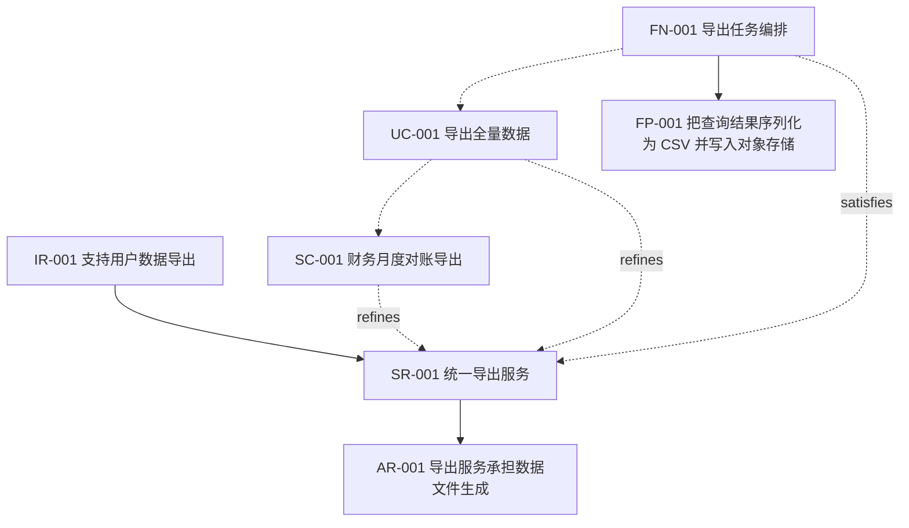

# BaiZeArchitect

BaiZe 软件全量设计套件：把需求从录入逐层拆成可追溯、可校验的设计条目（CLI ＋ 十个 skill ＋ pi/Claude Code 注入）。

不是应用本身——是装进 AI coding agent 的能力包。

## 包里有什么

- **CLI** —— `baize <new|validate|status|accept|rename|migrate>`：`new <layer>` 发号建条目，`validate` 校验，`status` 查链的全貌，`accept` 认领一条 `statement` 与 `acceptance`，`rename` 把条目里的清单引用跟到新 slug，`migrate` 把旧模型的条目搬到新形状（两条改写命令都默认 dry-run，`--write` 才落盘）。
- **十个 skill** —— 六个段 skill（`baize-ir` / `baize-sr` / `baize-ar` / `baize-scenario` / `baize-usecase` / `baize-function`）＋ 三个纪律 skill（`baize-validate` / `baize-review` / `baize-revise`）＋ 入口 `using-baize`。
- **pi 扩展** —— `extensions/baize-context.ts`：会话启动时注入 `using-baize` 的正文。
- **Claude Code plugin** —— `.claude-plugin/plugin.json` ＋ 一个 SessionStart hook，注入**同一份**正文。
- **探针** —— `probes/`：30 条真实模型调用，挡 skill 的触发退化。

**只想用** → [跑起来](#跑起来)。**想改这个仓库** → [改这个仓库](#改这个仓库)。

## 怎么运转

一条链长这样——`test/fixtures/chain-sample` 里那条真实的七层链：



实线是 `parent`（分解）；虚线都是多对多——带标签的是认领边（`refines` / `satisfies`：方案层条目接住哪条 SR），不带标签的是关联边（`appearsIn` / `realizes`）。

挑它当例子不是为了好看：它是 `npm run check:fixture` **每次都会严格校验**的那条链，所以这张图不会烂。

条目是 `baize/` 下的 markdown，与代码同仓、进 git。每个术语到底指什么，见 [`CONTEXT.md`](CONTEXT.md)——这里不重复它的定义。

## 跑起来

> [!NOTE]
> 本仓 `private: true`、版本 `0.0.0`，**尚未发布**：今天只有「从 checkout 装」这一条路。
> 还有一件事容易误会：**本仓根目录没有 `baize/`**。它是工具，不是一份设计——设计资产长在**你自己项目**的 `baize/` 下。
> 旧模型建的仓库（方案层条目用 `parent` 挂在 SR 下）：升级后跑一次 `baize migrate` 搬到新形状（默认 dry-run，确认后加 `--write` 落盘）。

### 装进你的 agent

```sh
# pi（1.2.0 实测；-l 装进项目本地的 .pi/settings.json，记的是相对路径）
pi install <本仓路径> -l

# Claude Code（--plugin-dir 只对本次会话生效）
claude --plugin-dir <本仓路径>
```

### 在你自己的项目里用它

**先摆两份受控清单**——本套件对它们**只读**（清单是输入，不是产物）；缺了而你又引用了，`validate` 会报 `ref.unknown-element` / `ref.unknown-catalog`：

```yaml
# baize/architecture.yaml —— 架构元素：AR 认领的那个组件。
# 「组件该怎么分」由你们定，本套件不回答（ADR-0004）。
components:
  export-service: { name: 导出服务, description: 产出可下载的数据文件 }
```

```yaml
# baize/scenario-catalogs.yaml —— 场景目录：场景归的那一类。
catalogs:
  compliance: { name: 合规与审计 }
```

```sh
npm install file:<本仓路径>    # 还没发布，先按路径装
npx baize new ir              # 发号建壳；baize/ 与各层目录会自动建
```

```console
$ npx baize new ir
已创建 baize/ir/IR-001.md（IR-001）

$ npx baize validate
校验：3 个问题（ERROR 3 / WARNING 0 / INFO 0）
  ERROR field.empty baize/ir/IR-001.md — 字段为空：title（人类可读的短名）
  ERROR field.empty baize/ir/IR-001.md — 字段为空：acceptance（至少要有一条验收线索）
  ERROR field.empty baize/ir/IR-001.md — 字段为空：statement（正文不能为空）
```

`new` 只发号建壳，所以刚建出来必然是空的——`validate` 就是拿来看「还差什么」的。填完再跑就是 `校验通过：0 个问题`（上面那条 fixture 链是零问题的样板）。退出码：`0` 干净 / `1` 有问题 / `2` 用法错。

**谁在干活**：日常你**不对 CLI 说话，对 agent 说话**——「把老板那段话记成一条需求」「IR-001 的验收确认过了，拆成系统需求」。段 skill 负责起草条目，纪律 skill 负责校验、复核与门禁前审阅；**CLI 是那台只认事实的机器**：发号、报错、算覆盖率与陈旧、给出门禁状态。

**一条链从零走完**：

| | 你这边 | 机器这边 |
|---|---|---|
| 1 · IR 录入 | 说「记一条需求：用户要能把数据带走」；agent 起草 `title` / `statement` / `acceptance` | `baize new ir` → `IR-001` |
| 2 · 认领（**人**） | **你**读一遍措辞与验收线索——这两样只能由人认领，agent 只起草 | `BAIZE_USER=你的名字 baize accept IR-001` |
| 3 · SR 拆分 | 说「按验收线索拆成系统需求」 | `baize new sr --parent IR-001 --covers IR-001#a1,IR-001#a2` |
| 4 · AR 分配（**人**） | 说「导出服务负责这条」——选哪个组件是架构决策，agent 只给建议 | `baize new ar --parent SR-001 --allocates export-service` |
| 5 · 场景 / 用例 / 功能 | 三段依次起草：场景讲情境、用例讲目标、功能项与功能点讲能力与实现。**认领边（`refines` / `satisfies`）与字段内容由 agent 起草、你确认** | `baize new scenario --catalog compliance`、`baize new usecase`、`baize new function-item`、`baize new function-point --parent FN-001`（骨架里带空的 `refines: []` / `satisfies: []` 待填） |
| 6 · 过门禁（**人**签字） | 三处门禁：IR 录入阻塞、SR→AR 提醒、功能拆分阻塞且要人签一句固定文案 | `baize status --chain IR-001` |
| 7 · 随时校验 | 动过任何条目就跑 | `baize validate` / `--strict` |

> 骨架刚建出来的方案层条目**不认领任何 SR**——所以它暂时**不属于任何链**（`status --chain` 里看不到它），`validate` 也会报孤儿（`ref.orphan`）。填上 `refines` / `satisfies`，它就进链、进覆盖率、进陈旧传播。

**日常就这几条命令**：

```console
$ npx baize validate                  # 现在有没有问题（门禁前、CI 里用）
$ npx baize status                    # 全仓：几条链、各自覆盖率进度与陈旧
$ npx baize status --chain IR-001     # 这条链：条目、三处门禁、待复核清单
$ npx baize accept SR-001             # 复核上游（改过上游之后跑它，陈旧才消）
```

**`baize/` 长这样**：

```text
baize/
├── ir/  sr/  ar/                        # 需求侧三层
├── scenarios/  usecases/                # 交互侧两层
├── function-items/  function-points/    # 能力两层
├── architecture.yaml                    # 受控清单：架构元素（外部维护，本套件只读）
├── scenario-catalogs.yaml               # 受控清单：场景目录（同上）
└── chains/                              # 只存「算不出来」的两样：跳过记录、功能拆分签字
```

**进 CI 一行**：`npx baize validate --strict`——WARNING 也算失败，于是「该看的都看过」由 CI 保证。

本仓自身的开发态，等价命令是 `npm run baize -- <命令>`。

## 改这个仓库

1. `npm run check` —— 类型 → 测试 → 构建 → skill 结构 → fixture 严格校验 → 装包冒烟，一体跑完。
2. 改了 `skills/` 下**任何**文件（含 `description`）→ `node probes/run.mjs --gate`：30 次真实模型调用、实测约 1 小时、取多数决。它**不在** `npm run check` 里。
3. 一次配置（每个 clone 一次）：`git config core.hooksPath .githooks`。
4. **不使用 PR**；提交信息是中文 conventional commit，且**带票号**。
5. 细节见 [`AGENTS.md`](AGENTS.md) 与 [`CODING_STANDARDS.md`](CODING_STANDARDS.md)。

## 文档

| 文件 | 什么时候看 |
|---|---|
| [`CONTEXT.md`](CONTEXT.md) | 想知道某个术语到底指什么——域模型的唯一来源 |
| [`AGENTS.md`](AGENTS.md) | agent 在这个仓库里该怎么干活：issue、triage、领域文档的位置 |
| [`CODING_STANDARDS.md`](CODING_STANDARDS.md) | 写代码与写测试的判断类规矩——`/code-review` 按它看 |
| [`docs/adr/`](docs/adr/) | 想知道某个设计为什么长这样：六个已定的决策 |
| [`docs/agents/`](docs/agents/) | issue tracker、triage 标签、域文档的具体约定 |
| [`probes/README.md`](probes/README.md) | 要跑探针，或想知道判定口径与观察项 |
