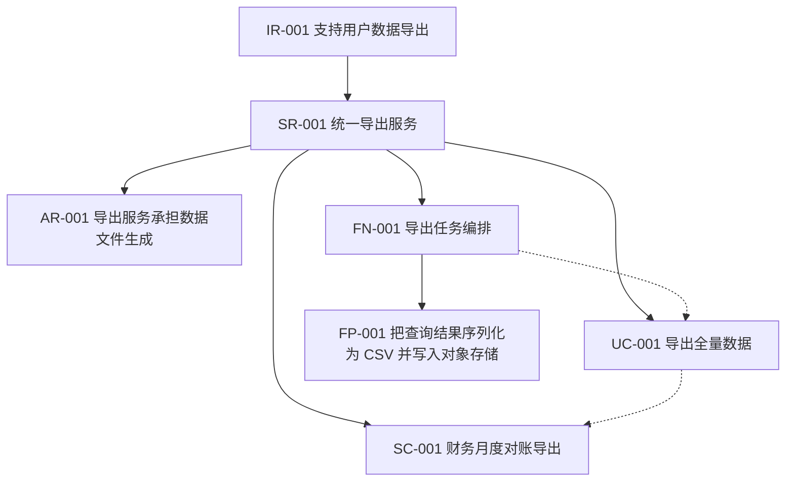

# BaiZeArchitect

BaiZe 软件全量设计套件：把需求从录入逐层拆成可追溯、可校验的设计条目（CLI ＋ 十个 skill ＋ pi/Claude Code 注入）。

不是应用本身——是装进 AI coding agent 的能力包。

## 包里有什么

- **CLI** —— `baize <new|validate|status|accept>`：`new <layer>` 发号建条目，`validate` 校验，`status` 查链的全貌，`accept` 认领一条 `statement` 与 `acceptance`。
- **十个 skill** —— 六个段 skill（`baize-ir` / `baize-sr` / `baize-ar` / `baize-scenario` / `baize-usecase` / `baize-function`）＋ 三个纪律 skill（`baize-validate` / `baize-review` / `baize-revise`）＋ 入口 `using-baize`。
- **pi 扩展** —— `extensions/baize-context.ts`：会话启动时注入 `using-baize` 的正文。
- **Claude Code plugin** —— `.claude-plugin/plugin.json` ＋ 一个 SessionStart hook，注入**同一份**正文。
- **探针** —— `probes/`：30 条真实模型调用，挡 skill 的触发退化。

**只想用** → [跑起来](#跑起来)。**想改这个仓库** → [改这个仓库](#改这个仓库)。

## 怎么运转

一条链长这样——`test/fixtures/chain-sample` 里那条真实的七层链：



实线是 `parent`（分解），虚线是 `appearsIn` / `realizes`（关联）。

挑它当例子不是为了好看：它是 `npm run check:fixture` **每次都会严格校验**的那条链，所以这张图不会烂。

条目是 `baize/` 下的 markdown，与代码同仓、进 git。每个术语到底指什么，见 [`CONTEXT.md`](CONTEXT.md)——这里不重复它的定义。

## 跑起来

> [!NOTE]
> 本仓 `private: true`、版本 `0.0.0`，**尚未发布**：今天只有「从 checkout 装」这一条路。
> 还有一件事容易误会：**本仓根目录没有 `baize/`**。它是工具，不是一份设计——设计资产长在**你自己项目**的 `baize/` 下。

### 装进你的 agent

```sh
# pi（1.2.0 实测；-l 装进项目本地的 .pi/settings.json，记的是相对路径）
pi install <本仓路径> -l

# Claude Code（--plugin-dir 只对本次会话生效）
claude --plugin-dir <本仓路径>
```

### 在你自己的项目里用它

```sh
npm install file:<本仓路径>    # 还没发布，先按路径装
npx baize new ir
```

```console
$ npx baize new ir
已创建 baize/ir/IR-001.md（IR-001）

$ npx baize validate
校验：3 个问题（ERROR 3 / WARNING 0 / INFO 0）
  ERROR field.empty baize/ir/IR-001.md — 字段为空：title（人类可读的短名）
  ERROR field.empty baize/ir/IR-001.md — 字段为空：acceptance（至少要有一条验收线索）
  ERROR field.empty baize/ir/IR-001.md — 字段为空：statement（正文不能为空）
```

`new` 只发号建壳，所以刚建出来必然是空的——`validate` 就是拿来看「还差什么」的。填完再跑就是 `校验通过：0 个问题`（上面那条 fixture 链是零问题的样板）。退出码：`0` 干净 / `1` 有问题 / `2` 用法错。

本仓自身的开发态，等价命令是 `npm run baize -- <命令>`。

## 改这个仓库

1. `npm run check` —— 类型 → 测试 → 构建 → skill 结构 → fixture 严格校验 → 装包冒烟，一体跑完。
2. 改了 `skills/` 下**任何**文件（含 `description`）→ `node probes/run.mjs --gate`：30 次真实模型调用、实测约 1 小时、取多数决。它**不在** `npm run check` 里。
3. 一次配置（每个 clone 一次）：`git config core.hooksPath .githooks`。
4. **不使用 PR**；提交信息是中文 conventional commit，且**带票号**。
5. 细节见 [`AGENTS.md`](AGENTS.md) 与 [`CODING_STANDARDS.md`](CODING_STANDARDS.md)。

## 文档

| 文件 | 什么时候看 |
|---|---|
| [`CONTEXT.md`](CONTEXT.md) | 想知道某个术语到底指什么——域模型的唯一来源 |
| [`AGENTS.md`](AGENTS.md) | agent 在这个仓库里该怎么干活：issue、triage、领域文档的位置 |
| [`CODING_STANDARDS.md`](CODING_STANDARDS.md) | 写代码与写测试的判断类规矩——`/code-review` 按它看 |
| [`docs/adr/`](docs/adr/) | 想知道某个设计为什么长这样：五个已定的决策 |
| [`docs/agents/`](docs/agents/) | issue tracker、triage 标签、域文档的具体约定 |
| [`probes/README.md`](probes/README.md) | 要跑探针，或想知道判定口径与观察项 |
