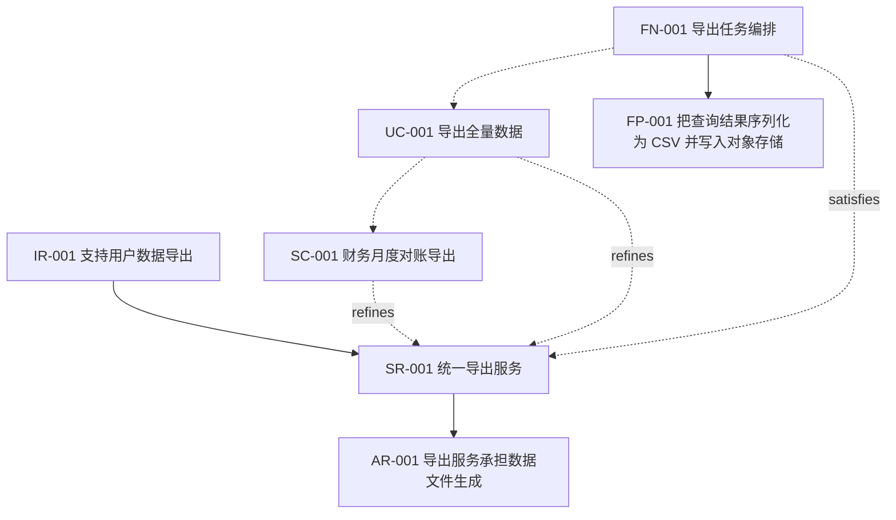

# BaiZeArchitect

BaiZe 是一套「软件全量设计」工具包：它把需求从录入开始逐层拆解，得到可追溯、可校验的设计条目。工具包由三部分组成：一个命令行工具、十个 skill，以及面向 pi 与 Claude Code 的会话注入。

它不是应用本身，而是装进 AI 编码 agent 的能力包。

## 包含什么

- **命令行工具**——`baize <new|validate|status|accept|retire|rename|migrate>`：`new <layer>` 创建条目并分配编号，`validate` 校验条目，`status` 查看全部链条的状态，`accept` 记录一次人工确认或复核（IR 是确认其 `statement` 与 `acceptance`，下游条目是记录对上游的复核），`retire` 让条目带着理由退出推进（`--undo` 撤销），`rename` 在清单条目的 slug 变更后改写所有引用，`migrate` 把旧模型的条目改写为新形状。两条改写命令默认只做演练，加 `--write` 才写入文件。
- **十个 skill**——六个段 skill、三个纪律 skill，以及入口 skill `using-baize`。各自的触发时机与产出见[十个 skill](#十个-skill)。
- **pi 扩展**——`extensions/baize-context.ts`：在会话启动时注入 `using-baize` 的正文。
- **Claude Code 插件**——`.claude-plugin/plugin.json` 与一个 SessionStart hook，注入同一份正文。
- **探针**——`probes/` 目录中的 30 条真实模型调用，用于发现 skill 触发能力的退化。

**只想使用** → [开始使用](#开始使用)。**想参与开发** → [参与本仓库开发](#参与本仓库开发)。

## 工作方式

一条完整的链条如下所示，这是 `test/fixtures/chain-sample` 中真实存在的那条七层链：



实线表示 `parent`（分解关系）；虚线都是多对多关系，其中带标签的是认领边（`refines` / `satisfies`：说明方案层条目接住了哪条 SR），不带标签的是关联边（`appearsIn` / `realizes`）。

之所以选这条链作为示例，是因为 `npm run check:fixture` 每次都会严格校验它，所以这张图不会过时。

条目是 `baize/` 目录下的 markdown 文件，与代码放在同一个仓库中并提交到 git。每个术语的确切含义见 [`CONTEXT.md`](CONTEXT.md)，本文不重复定义。

## 十个 skill

六个段 skill 各负责链条的一段，触发条件都是「上一段的产物已经存在、这一段的产物还不存在」；三个纪律 skill 不绑定到某一阶段，而是随事件触发（写完就校验、门禁前审阅、上游变更后回改）。每一段都由 agent 起草、由人审定，下表最后一列只说明这一段的把关点落在哪里。

| skill | 触发时机 | 这一段做什么（谁把关） |
|---|---|---|
| `using-baize` | 在带 `baize/` 目录的项目中开启任何会话，或对话中提到 IR / SR / AR / 场景 / 用例 / 功能拆分 | 入口。说明六段链条与分工：结构、引用、覆盖率、陈旧这类**机械规则由 CLI 保证**，什么算一条好需求、拆到什么粒度、覆盖到什么程度才算够这类**判断由 skill 承担**；然后把对话导向当前应当进入的那一段 |
| `baize-ir` | 需求以自然语言提出、还没有 IR 条目；或已有 IR 的 `statement` / `acceptance` 尚未确认 | 产出一条 IR：一句话陈述加至少一条验收线索。`baize new ir` 只创建空条目，内容由 agent 起草；**陈述与验收线索必须由人执行 `baize accept` 确认**，它是整条链的对账基准 |
| `baize-sr` | IR 的验收线索已确认，覆盖这些线索的 SR 尚不存在 | 产出若干 SR，父条目是那条 IR，`covers` 指向具体的验收线索。粒度的下界是「能被一条 AR 唯一认领」，上界是「不跨多个可独立验收的行为」。覆盖情况按**验收线索逐条**对账，「这条 IR 已经有 SR 了」不算数 |
| `baize-ar` | 某条 SR 还没有架构元素为之负责 | 每条 SR 产出一条 AR，`allocates` 恰好指向一个元素；共同承担时不写多值，而是拆成两条 AR 各指同一条 SR。元素来自 `baize/architecture.yaml`（**由外部维护，本套件只读**，也不回答组件应当如何划分），选择哪个元素属于人的架构决策，因此 SR→AR 门禁是提醒类 |
| `baize-scenario` | 某条 SR 还没有场景，或需要记录新的使用情境 | 产出场景条目：用 `refines` 认领 SR（必填、可多值），按场景目录分类，可以挂父场景（用于主流程与异常流程）。场景**不需要人工确认**，字段齐备且 `validate` 没有 ERROR 即算完成 |
| `baize-usecase` | 场景已经存在，其中目标导向的交互还没有记录下来 | 产出用例条目：用 `refines` 认领 SR，用 `appearsIn` 记录它出现在哪些场景中。用例必须与场景**形状不同**（差别在 `goal` 与后置承诺），否则这一级只是把同一件事写了两遍 |
| `baize-function` | 用例已经存在，实现这些用例的功能还没有拆分到功能点 | 分两层。功能项很薄（短名加一句话，用 `satisfies` 认领 SR、用 `realizes` 连接用例），薄是刻意设计而非遗漏；功能点是最小可测单元，五项内容字段齐备。完成后还有一关：**功能拆分门禁需要人签署一句话** |
| `baize-validate` | 任何条目刚写完或刚改完（改动再小也一样），以及通过任何门禁之前 | 说明如何解读 `baize validate`：报告按域分组，处理动作也随之固定——`ref.` 去改引用，`coverage.` 去对照上游义务清单，`field.` 去补字段，`stale.` 去复核，`id.` 去改编号，`stage.` 与 `catalog.` 去补记录或找人。小幅改动最容易破坏引用，所以不存在「这次不用跑」的情况 |
| `baize-review` | 需要人工过目、确认或提交之前，或需要一份可读摘要时 | 把 `baize status` 中的门禁逐项列出。`kind: auto` 的门禁（IR 录入、SR→AR）由事实计算得出，未通过就说明事实不对，应当回去修改条目；`kind: signed` 的门禁（功能拆分）取决于人的判断，**agent 不能代签**，它只负责把两张清单（未覆盖的用例、未复核的陈旧）摆到人面前 |
| `baize-revise` | `baize status` 报告下游陈旧，或上游在上一次展开之后被修改过 | 链级动作，不属于任何一段：先读上游改了什么，再判断这对下游意味着什么，改完下游之后，还需要按复核方向对上游执行一次 `baize accept`。陈旧比对的是**内容指纹而非时间**，因此提交不会让它消失 |

## 开始使用

> [!NOTE]
> 本仓库 `private: true`、版本号 `0.0.0`，**尚未发布**，目前只能从 checkout 安装。
> 另有一处容易误会：**本仓库根目录没有 `baize/` 目录**。本仓库是工具，不是一份设计；设计资产位于你自己项目的 `baize/` 目录下。

### 安装到 agent

```sh
# pi（1.2.0 实测；-l 表示安装到项目本地的 .pi/settings.json，记录的是相对路径）
pi install <本仓路径> -l

# Claude Code（--plugin-dir 只对本次会话生效）
claude --plugin-dir <本仓路径>
```

### 在项目中开始工作

**无需提前准备，直接在项目中对 agent 说明需求即可**：

> 把这段话记成一条需求：用户要能把自己的数据带走，不能锁死在系统里

agent 会创建 `baize/ir/IR-001.md`，并起草 `title` / `statement` / `acceptance`。`baize new` 只创建空条目，内容由 agent 填写。**这几项只能由人确认**：读一遍，认为表述正确就说「确认这条」，agent 会执行 `baize accept IR-001`，把这一版固定下来。

此后的过程都是同一模式的变体：**拆成系统需求 → 确定由谁负责 → 补充场景、用例与功能**。每一段都有对应的 skill，由 agent 起草、由人审定。一篇 markdown 对应一个条目，按层存放在 `baize/` 下的七个目录中。

**只有三件事必须由人完成**：确认 IR 的陈述与验收线索（它是整条链的对账基准）；决定每条 SR 由哪个组件负责（架构是外部输入）；功能拆分时签署一句「这套功能拆分足以支撑实现；未覆盖的用例与未复核的陈旧已处置。」

### 排查问题只需两条命令

```console
$ npx baize validate     # 现在缺什么：哪个文件、哪个字段、怎么补
$ npx baize status       # 有几条链、覆盖率进度、哪里陈旧、门禁卡在哪里
```

```console
$ npx baize validate
校验：3 个问题（ERROR 3 / WARNING 0 / INFO 0）
  ERROR field.empty baize/ir/IR-001.md — 字段为空：title（人类可读的短名）
  ERROR field.empty baize/ir/IR-001.md — 字段为空：acceptance（至少要有一条验收线索）
  ERROR field.empty baize/ir/IR-001.md — 字段为空：statement（正文不能为空）
```

报告按域分组，处理方向也随之确定——`field.` 去补字段，`ref.` 去改引用，`coverage.` 去补覆盖，`stale.` 去复核上游，`catalog.` 去找清单维护人。退出码 `0` 表示没有问题，`1` 表示有问题，`2` 表示用法错误。接进 CI 时使用 `npx baize validate --strict`（提醒级问题也算失败）。

**第一次使用会遇到的三种情况**（无需事先记住，agent 会提醒）：

- **需要指定组件，但清单中没有**——`baize/architecture.yaml` 由**你们团队**维护（本套件只读，也不回答组件应当如何划分），格式如 `components: { export-service: { name: 导出服务 } }`；场景目录同理，位于 `baize/scenario-catalogs.yaml`。
- **新建的场景 / 用例 / 功能项没有认领任何 SR**——它暂时不属于任何链，`validate` 会报告它是孤立条目；让它认领一条 SR 即可进入链中。
- **仓库使用旧模型**（方案层条目还挂着 `parent`）——执行一次 `npx baize migrate`，默认只查看不修改，确认后加 `--write`。

如需深入了解，请查阅 [`CONTEXT.md`](CONTEXT.md)（每个术语的定义）与 [`docs/adr/`](docs/adr/)（设计缘由）。在本仓库自身开发时，等价命令是 `npm run baize -- <命令>`。

## 参与本仓库开发

1. `npm run check`——依次执行类型检查、测试、构建、skill 结构检查、文档引用检查、fixture 严格校验与装包冒烟测试。
2. 只要修改了 `skills/` 下的**任何**文件（包括 `description`），就要执行 `node probes/run.mjs --gate`：30 次真实模型调用，实测约需 1 小时，按多数决判定。它**不在** `npm run check` 之内。
3. 每个 clone 配置一次：`git config core.hooksPath .githooks`。
4. **本仓库不使用 PR**；提交信息采用中文 conventional commit，并带上票号。
5. 细节见 [`AGENTS.md`](AGENTS.md) 与 [`CODING_STANDARDS.md`](CODING_STANDARDS.md)。

## 文档

| 文件 | 何时查阅 |
|---|---|
| [`CONTEXT.md`](CONTEXT.md) | 需要确认某个术语的准确含义时——域模型的唯一来源 |
| [`AGENTS.md`](AGENTS.md) | 需要了解 agent 在本仓库中的工作方式时：issue、triage、领域文档的位置 |
| [`CODING_STANDARDS.md`](CODING_STANDARDS.md) | 需要了解写代码与写测试的判断类规矩时——`/code-review` 依据它评审 |
| [`docs/adr/`](docs/adr/) | 需要了解某个设计为何如此时：八个已定的决策 |
| [`docs/agents/`](docs/agents/) | 需要 issue tracker、triage 标签、域文档的具体约定时 |
| [`probes/README.md`](probes/README.md) | 需要运行探针，或了解判定口径与观察项时 |
